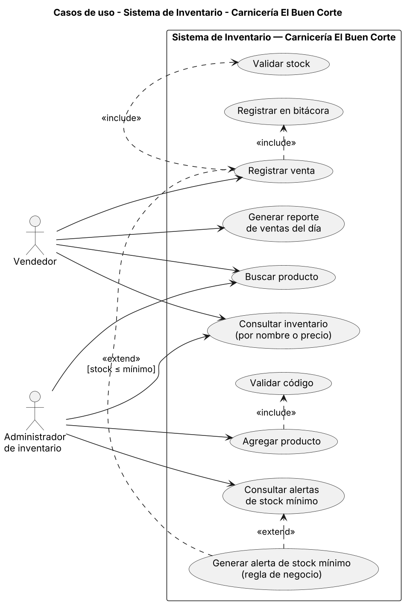
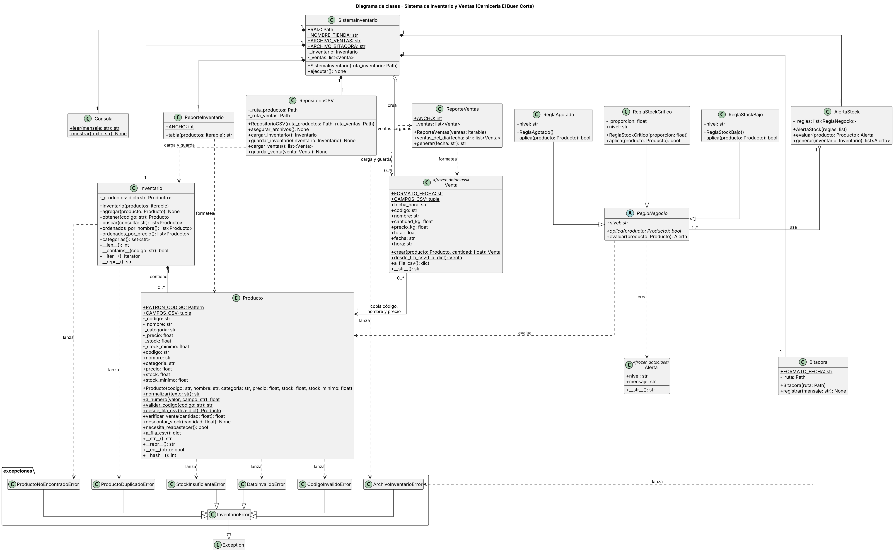

# Sistema de Inventario y Ventas — Carnicería El Buen Corte (POO)

- **Estudiante:** Diego Alejandro Naves Hunzelmann
- **Carné:** 7691-25-9658
- **Curso:** Algoritmos · Universidad Mariano Gálvez (UMG) · Ciclo 2-2026
- **Docente:** Ing. Luis Fernando Alvarado Cruz
- **Proyecto Final:** refactorización con Programación Orientada a Objetos del Proyecto 1

## Tema y regla especial
**Tema:** inventario y ventas por kilogramo de una carnicería.
**Regla 2 — Alerta de stock mínimo:** cada producto tiene un `stock_minimo`. Si el stock lo alcanza o lo baja, el sistema avisa al iniciar, tras cada venta y en la opción 7. Tres niveles (polimorfismo con `ReglaNegocio`): **AGOTADO** (0 kg), **CRÍTICO** (≤ 50 % del mínimo) y **BAJO** (≤ mínimo). Ejemplo: Longaniza, mínimo 3 kg; al vender 9 de 10 kg quedan 1 kg → `[CRÍTICO]`.

## Cómo ejecutarlo
Requiere Python 3.9 o superior, sin instalar nada.
```bash
python main.py
python -m unittest discover -s tests    # pruebas (opcional)
```

## Estructura
```
main.py                 punto de entrada
inventario/
  excepciones.py        InventarioError y 6 excepciones hijas
  modelos.py            Producto, Venta
  inventario.py         Inventario
  reglas.py             ReglaNegocio, ReglaAgotado, ReglaStockCritico, ReglaStockBajo, Alerta, AlertaStock
  persistencia.py       RepositorioCSV, Bitacora
  reportes.py           ReporteInventario, ReporteVentas
  app.py                Consola, SistemaInventario
datos/inventario.csv    10 productos (ventas.csv y bitacora.log se crean al usar)
docs/                   diagramas (.png + .puml) y reflexion.md
evidencias/             pruebas de ejecución (.txt y .png)
tests/                  pruebas unitarias
```

## Clases
| Clase | Responsabilidad |
|---|---|
| `Producto` | Datos y validaciones de un producto (encapsulado con propiedades) |
| `Venta` | Registro inmutable de una venta (`dataclass` frozen) |
| `Inventario` | Diccionario de productos: alta, búsqueda, orden, categorías |
| `ReglaNegocio` (abstracta) | Contrato de la regla: `aplica()` y `evaluar()` |
| `ReglaAgotado`, `ReglaStockCritico`, `ReglaStockBajo` | Niveles concretos de la alerta |
| `Alerta` | Aviso inmutable (nivel y mensaje) |
| `AlertaStock` | Aplica las reglas a un producto o a todo el inventario |
| `RepositorioCSV` | Lee y escribe inventario y ventas (guardado seguro con archivo temporal) |
| `Bitacora` | Registra operaciones con fecha/hora en modo append |
| `ReporteInventario` / `ReporteVentas` | Dan formato de columnas alineadas |
| `Consola` | Entrada y salida de consola |
| `SistemaInventario` | Menú y coordinación; captura las excepciones |
| `InventarioError` y derivadas | Errores propios (código inválido, stock insuficiente, no encontrado, etc.) |

## Diagramas UML
Casos de uso:



Diagrama de clases:



Fuentes editables: `docs/casos_de_uso.puml` y `docs/diagrama_clases.puml`.

## Ejemplo de uso
```
Seleccione una opción (1-8): 3
--- REGISTRAR VENTA ---
Código del producto: EMB002
Longaniza - Q36.00/kg - Disponible: 10.00 kg
Cantidad vendida en kg: 9
Venta registrada. Total a cobrar: Q324.00
¡Atención! [CRÍTICO] Longaniza: 1.00 kg (mínimo 3.00 kg)

Seleccione una opción (1-8): 3
Código del producto: EMB002
Cantidad vendida en kg: 5
Error: Stock insuficiente de EMB002: pides 5.00 kg y hay 1.00 kg.
```
Más pruebas en [`evidencias/`](evidencias/).

## Reflexión
[docs/reflexion.md](docs/reflexion.md)
